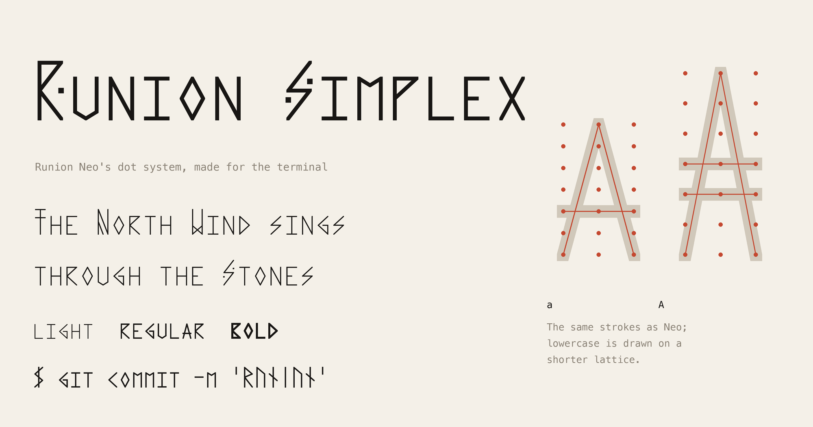
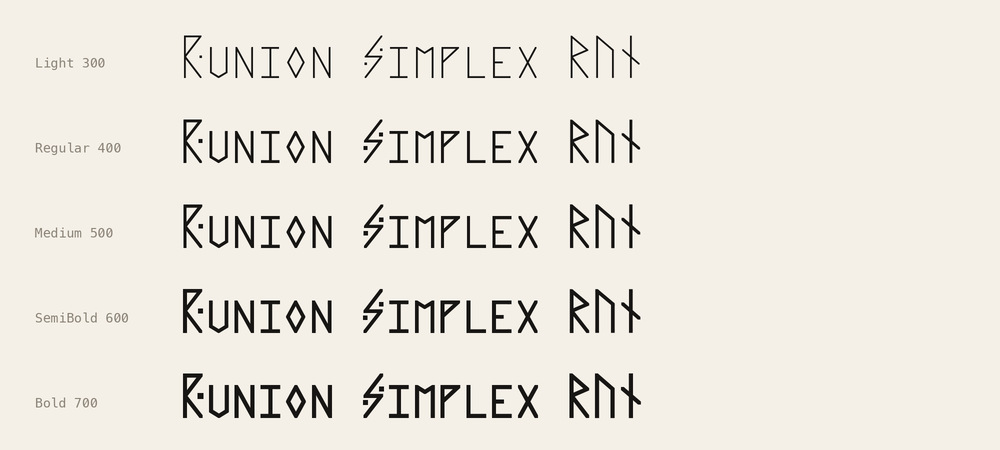
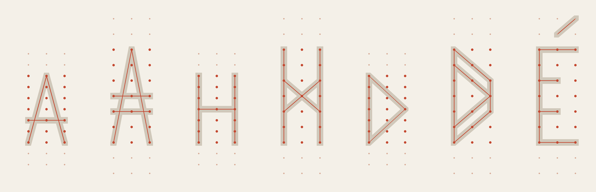

# Runion Simplex

Runion Neo's dot system, made for the terminal.

Runion Simplex is the monospaced sibling of [Runion Neo](https://github.com/OneManMobile/runion-neo). It draws exactly the same glyphs, every Latin letter, every ornamented capital and the whole Unicode Runic block, from the same strokes between the same 3 × 7 dots. Only the geometry changes, so it reads in a terminal: lowercase stands shorter than its capitals, and the cell is a little wider. It comes in every weight from Light to Bold.



## Get it

- **Font:** [`fonts/variable/RunionSimplex[wght].ttf`](fonts/variable/RunionSimplex%5Bwght%5D.ttf), one variable file with every weight from 300 to 700 and named Light, Regular, Medium, SemiBold and Bold.
- **Web:** [`fonts/webfonts/RunionSimplex[wght].woff2`](fonts/webfonts/RunionSimplex%5Bwght%5D.woff2).
- **Website:** open [`index.html`](index.html) or run `make serve` (http://localhost:8418). It shows the font on a terminal monitor you can switch between phosphor colours and take fullscreen, a legibility strip at small sizes, a type tester, every glyph, and the sketchpad for drawing on the dots.
- **Licence:** [SIL Open Font License 1.1](OFL.txt).



## What changes from Neo



Neo is unicase: a lowercase letter and its capital are the same height, and the capital differs only by its ornament. At display sizes that is the point; at 13 px in a terminal the ornaments are a pixel or two and every word becomes a rectangle. Simplex keeps every stroke and changes the lattice the strokes are drawn on:

| | Runion Neo | Runion Simplex |
| --- | --- | --- |
| Glyphs | `sources/glyphs.txt` | the same file: same strokes, same dots, same runes |
| Rows | 120 units apart | capitals, digits, runes and symbols: 120 · **lowercase: 86** |
| Height | unicase, everything 770 tall | capitals 770 · **lowercase 566**, about three quarters |
| Columns | 120 units apart | **140** |
| Cell | 400 units | **460** |
| Pen | Light 32 · Regular 50 · Bold 74 | the same |

A lowercase letter is any glyph whose character is a lowercase letter (Unicode `Ll`), including its accented forms; it is drawn on the shorter lattice, so a and A still share their strokes but no longer their height. Accents come down with their letter, because the attic rows are part of the same lattice. Everything else (the nib, the clipped corners, the 1.4-pen dots, the composed accents) works exactly as in Neo; see Neo's README for the letters and the capital ornaments.

The geometry lives in the settings at the top of [`sources/glyphs.txt`](sources/glyphs.txt): `@advance`, `@cell_w`, `@cell_h` and `@cell_x`.

## Using the font

```css
@font-face {
  font-family: "Runion Simplex";
  src: url("RunionSimplex[wght].woff2") format("woff2");
  font-weight: 300 700;
}
code, pre, .terminal { font-family: "Runion Simplex", monospace; }
```

To use it in a terminal, install `fonts/variable/RunionSimplex[wght].ttf` and choose "Runion Simplex" in the terminal's font settings.

It covers the Google Fonts Latin Core character set (319 characters) and the whole Unicode Runic block (89 characters, U+16A0–U+16F8).

## Building

```bash
make venv     # once: Python environment with fontmake, ufoLib2, shapely, pillow, gftools, fontbakery
make build    # glyphs.txt → UFOs → fonts/variable, fonts/webfonts, website data
make gftools  # the Google Fonts path: gftools builder compiles fonts/ from sources/config.yaml
make proof    # contact sheet (out/) and documentation images
make test     # fontbakery, Google Fonts profile
```

`sources/runion.py` is Neo's engine with one addition: `Params.cell_x` and `Params.lattice(short)`, the shorter lattice for lowercase. `sources/build.py` gives every base glyph its own mark anchor at its own top, so combining accents sit as low over a lowercase letter as the composed ones do.

## How it was made

Runion Simplex grew out of [Runion Neo](https://github.com/OneManMobile/runion-neo). It was made with AI: I worked with Claude, Anthropic's AI model, in Claude Code. The glyphs are Neo's, which I designed; for Simplex I chose the direction (keep every stroke, change only the geometry) and reviewed the results. Claude wrote the geometry changes, the build and the website. No existing font data or outlines were used; every outline is generated from `sources/glyphs.txt`.

## Licence

Copyright 2026 The Runion Simplex Project Authors (https://github.com/OneManMobile/runion-simplex).

This Font Software is licensed under the SIL Open Font License, Version 1.1. The licence is in [`OFL.txt`](OFL.txt) and is also available with a FAQ at https://openfontlicense.org.
